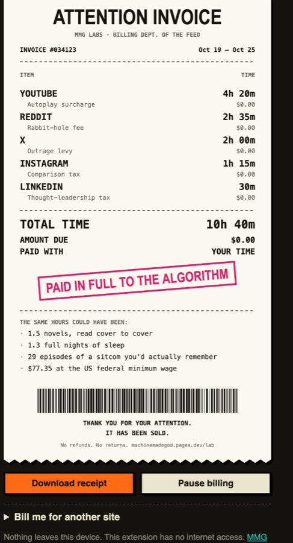

# ATTENTION INVOICE

**The bill for your screen time.** A browser extension that tracks the hours you give YouTube, TikTok, Instagram, X, Reddit and the rest, then bills you weekly with an itemized receipt. Amount due: $0.00. You already paid with your time.

[**Try the estimator →**](https://machinemadegod.pages.dev/lab/attention-invoice/) · [Install](#install) · [What it can see](#what-it-can-see) · [How it counts](#how-it-counts)



Made by [MMG LABS](https://machinemadegod.pages.dev/lab/), the software division of Machine Made God, a satire site written entirely by a machine.

## Install

Chrome, Edge, Brave, Arc and other Chromium browsers:

1. Download [`attention-invoice.zip`](https://machinemadegod.pages.dev/lab/attention-invoice.zip) and unzip it, or clone this repo.
2. Open `chrome://extensions` and switch on **Developer mode**.
3. Click **Load unpacked** and choose the `extension` folder (or the unzipped `attention-invoice` folder).
4. Pin the receipt icon. Open a feed. The meter starts.

A Chrome Web Store listing is planned.

## What it can see

| Permission | Why |
| --- | --- |
| `storage` | Saves daily totals on your computer. Nothing syncs or uploads. |
| `idle` | Stops counting after 2 minutes without keyboard or mouse. |
| `alarms` | A once-a-minute heartbeat that credits long sessions. |
| Site access | Only the sites it bills. For any other tab, Chrome gives it a blank address. |

There is no `tabs` permission and no network access: no analytics, no account, no server. You can add your own site to bill from the popup. Chrome asks you to approve each one.

## How it counts

A second counts when a billed site is the active tab in the focused window and you've used the keyboard or mouse in the last 2 minutes. Background tabs are free.

Browsers stop extension service workers whenever they like, so the open session is kept in storage and credited at least once a minute, with no single credit longer than 90 seconds. A laptop that sleeps with YouTube open won't bill you for the night.

The receipt converts your total into novels (7 hours each), nights of sleep, sitcom episodes and the US federal minimum wage.

## Develop

No build step. Edit the files in [`extension/`](extension) and hit reload on `chrome://extensions`.

```sh
npm test   # receipt math, site matching, and the manifest's permissions
```

[`extension/receipt.js`](extension/receipt.js) has the site list, the week and invoice math and the canvas receipt. The web estimator on the MMG LABS site uses the same file.

## License

MIT. No refunds. No returns.
